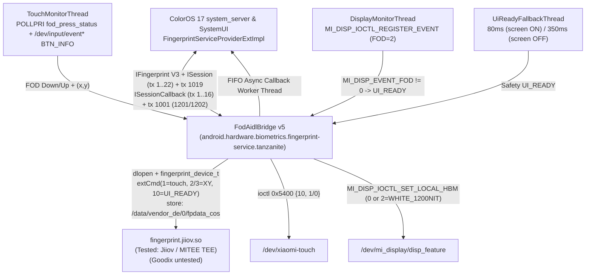

# ColorOS 17 Optical FOD (Fingerprint) AIDL V3 Bridge (`tanzanite`)

A standalone, zero-`libc++_shared.so` native C++ AIDL V3 Fingerprint HAL bridge that connects **Xiaomi's legacy optical under-display fingerprint HAL (`fingerprint.jiiov.so`) + Xiaomi display LHBM (`/dev/mi_display/disp_feature`) + touch FOD (`/dev/xiaomi-touch`, `fod_press_status`, `BTN_INFO`)** directly to **ColorOS 17 `IFingerprint` V3 + Oplus custom FOD transactions (`1019` / `1001`)**.

> [!IMPORTANT]
> **Sensor Support Notice**:
> - **Tested & confirmed working**: **Jiiov** optical FOD (`fingerprint.jiiov.so`) on Redmi Note 14 4G (`tanzanite`).
> - **Untested**: **Goodix** (`fingerprint.goodix_fod.so` / `fingerprint.goodix.so`), **FPC** (`fingerprint.fpc_fod.so`), and **Silead** (`fingerprint.silead.so`). Although fallback probe paths exist in `openFingerprintHal()`, **Goodix and non-Jiiov variants have NOT been tested on hardware** — their `extCmd` / vendor acquired codes may differ from Jiiov.

---

## Test Environment & ROM Baseline

| Component | Details |
| :--- | :--- |
| **Test Device** | Redmi Note 14 4G (`tanzanite`, SKU `tanzanite_n_gl`) |
| **SoC / ABI** | MediaTek Helio G99-Ultra (`MT6789`), `arm64-v8a`, VNDK 31 |
| **Display** | 1080×2400 AMOLED (`panel_o7_38_0c_0a_dsc_vdo`, FOD center `(540, 2109)`, radius `93 px`) |
| **Optical Sensor Tested** | **Jiiov (`fingerprint.jiiov.so` + MITEE TEE)** — *Goodix untested* |
| **Kernel** | `5.10.269-EvernightKernel-Android-PERMISSIVE` |
| **Stock Firmware (Base Vendor)** | HyperOS 2 — `OS2.0.214.0.VOGEUXM` (`Redmi/tanzanite/tanzanite:12/SP1A.210812.016/OS2.0.214.0.VOGEUXM:user/release-keys`, Android 12 / SDK 31 vendor) |
| **ColorOS Version** | ColorOS 17 (`V17.0.0`, Android 17 / SDK 37) |
| **ColorOS Base ROM** | OnePlus Ace 5 Ultra CN (`PLC110`), `PLC110_11_A.01` (`PLC110_11.A.01_001_202610210112`, `CP2A.260605.016 release-keys`) |
| **Deployment Method** | DSU (`vendor.img` repacked with `mkfs.erofs`) |

---

## What Is Bridged

| Layer | Target / Backend |
| :--- | :--- |
| **Exposed Service** | `android.hardware.biometrics.fingerprint.IFingerprint/default` (Stable AIDL V3, hash `637371b53fb7faf9bd43aa51b72c23852d6e6d96`, `UNDER_DISPLAY_OPTICAL`) |
| **ColorOS Custom Binder Protocol** | Inbound `IFingerprint::sendFingerprintCmd` (tx `1019`: `1010` enroll total steps, `1011` screen state)<br>Outbound `ISessionCallback::onFingerprintCmd` (tx `1001`: `1201` touch-down + uptimeMillis, `1202` touch-up) |
| **Legacy Vendor HAL Backend** | `dlopen("/vendor/lib64/hw/fingerprint.jiiov.so")` (tested on Jiiov; fallback probes for `goodix_fod`/`goodix`/`fpc_fod`/`silead` are untested) via `fingerprint_device_t` + Xiaomi `extCmd()` |
| **Display Illumination (LHBM)** | `/dev/mi_display/disp_feature` — `MI_DISP_IOCTL_SET_LOCAL_HBM` (`0x400c440e`, mode `2 = LOCAL_HBM_NORMAL_WHITE_1200NIT`) & `MI_DISP_IOCTL_REGISTER_EVENT` (`0x400c4407`, `MI_DISP_EVENT_FOD = 2`) |
| **Touch FOD Hardware** | `/dev/xiaomi-touch` (`0x5400`, `TOUCH_MODE_FOD_ENABLE = 10`), `/sys/class/touch/touch_dev/fod_press_status` (`POLLPRI`), and `/dev/input/event*` (`BTN_INFO = 0x152` + `ABS_MT_POSITION_{X,Y}`) |
| **Replaces Stock Binary** | `/vendor/bin/hw/android.hardware.biometrics.fingerprint@2.1-service` (HIDL 2.1, incompatible with ColorOS 17 AIDL V3 + Oplus FOD UI pipeline) |

---

## Files Bridged / Modified

| File Path | Action | Mode / Owner | SELinux Context |
| :--- | :--- | :--- | :--- |
| `vendor/bin/hw/android.hardware.biometrics.fingerprint-service.tanzanite` | **Added** | `0755` (`0:2000`) | `u:object_r:hal_fingerprint_default_exec:s0` |
| `vendor/etc/init/android.hardware.biometrics.fingerprint@2.1-service.rc` | **Replaced** | `0644` (`0:0`) | `u:object_r:vendor_configs_file:s0` |
| `vendor/etc/vintf/manifest/android.hardware.biometrics.fingerprint@2.1-service.xml` | **Replaced** | `0644` (`0:0`) | `u:object_r:vendor_configs_file:s0` |

### Required Stock Vendor Files (Keep Unmodified from Base Vendor)
- `/vendor/lib64/hw/fingerprint.jiiov.so` (and its MITEE/vendor dependencies)
- Geometry properties (already present in stock `tanzanite` vendor props, read dynamically at boot):
  - `persist.vendor.sys.fp.fod.location.X_Y` (fallback: `persist.vendor.fingerprint.optical.sensorlocation`)
  - `persist.vendor.sys.fp.fod.size.width_height` (fallback: `persist.vendor.fingerprint.optical.iconsize`)

---

## How the Logic Works

### Why Stock Xiaomi Fingerprint HAL Breaks on ColorOS 17
1. **HIDL 2.1 vs AIDL V3**: ColorOS 17 expects `android.hardware.biometrics.fingerprint.IFingerprint/default` V3 (`UNDER_DISPLAY_OPTICAL`, `SensorLocation`, `TouchDetectionParameters`) and does not work properly with Xiaomi's legacy HIDL 2.1 daemon.
2. **Xiaomi Optical FOD Sequence**: Xiaomi's Jiiov optical sensor (`fingerprint.jiiov.so`) will **not** capture a valid fingerprint image unless:
   - `/dev/xiaomi-touch` has `TOUCH_MODE_FOD_ENABLE (10)` enabled,
   - Local HBM is turned ON via `/dev/mi_display/disp_feature` (`mode = 2` = `LOCAL_HBM_NORMAL_WHITE_1200NIT`; mode `4` is green 500 nit factory test and blinds the sensor!),
   - `extCmd(1, 1)` (finger down), `extCmd(2, x)` / `extCmd(3, y)`, and `extCmd(10, 1)` (`UI_READY` once `MI_DISP_EVENT_FOD` fires) are delivered in exact order.
3. **ColorOS 17 FOD UI Synchronization**: ColorOS SystemUI requires custom outbound callback `ISessionCallback::onFingerprintCmd` (tx `1001`) with `cmdId=1201` (touch-down + 8-byte LE `uptimeMillis`) and `cmdId=1202` (touch-up) to drive the pressed icon animation and screen-off wake pipeline, plus `sendFingerprintCmd(1019, cmdId=1010)` returning `-1` so enrollment computes total steps dynamically (`remaining + 1`).
4. **Synchronous Enumeration Race Condition**: `fingerprint.jiiov.so` invokes `FINGERPRINT_TEMPLATE_ENUMERATING` synchronously *inside* `enumerate()`. Forwarding that callback before `ISession::enumerateEnrollments()` returns `STATUS_OK` races with `FingerprintInternalEnumerateClient` in `system_server`.
5. **DSU Dual-Boot Template Isolation**: Sharing `/data/vendor_de/0/fpdata` between host HyperOS 2 and DSU ColorOS 17 causes `FingerprintService` to wipe templates across reboots due to mismatched `authenticatorId` / framework DB records.

### Bridge Architecture



### Detailed Implementation Breakdown
1. **Dynamic FOD Geometry (`loadFodGeometryFromProps`)**:
   - Reads `persist.vendor.sys.fp.fod.location.X_Y` and `persist.vendor.sys.fp.fod.size.width_height` at startup (converting top-left + width/height into center `(540, 2109)` and radius `93`) and reports it in `IFingerprint::getSensorProps()` as `UNDER_DISPLAY_OPTICAL (3)` with `STRONG (2)` strength and `maxEnrollmentsPerUser = 5`.
2. **Dual-Boot Template Persistence (`/data/vendor_de/<uid>/fpdata_cos`)**:
   - `IFingerprint::createSession()` creates `/data/vendor_de/<uid>/fpdata_cos` (`0770 system:system`) and passes it to `set_active_group()`, keeping ColorOS templates isolated from stock HyperOS 2's `/data/vendor_de/0/fpdata` in MITEE secure storage.
3. **Ordered Asynchronous Callback Queue (`cbWorkerLoop` / `postCallback`)**:
   - All outbound `ISessionCallback` calls (`onChallengeGenerated`, `onEnrollmentProgress`, `onAuthenticationSucceeded`, `onEnrollmentsEnumerated`, `onEnrollmentsRemoved`, `onFingerprintCmd`, etc.) are dispatched on a single FIFO worker thread *after* `ISession::onTransact` replies `STATUS_OK`, completely eliminating re-entrant binder deadlocks and enumeration races.
4. **Hardware FOD Capture Pipeline (`onFodFingerEvent`)**:
   - **Touch detection**: `TouchMonitorThread` watches both `/sys/class/touch/touch_dev/fod_press_status` (`POLLPRI`) and `/dev/input/event*` (`BTN_INFO = 0x152` + scaled `ABS_MT_POSITION_X/Y`), with automatic coordinate hit-testing fallback if `fod_press_status` is absent.
   - **On Finger Down**:
     1. Immediately sends ColorOS `onFingerprintCmd(1001, cmdId=1201, uptimeMillis)` so the pressed glow and screen-off wake pipeline start with zero latency.
     2. Sends touch `(x, y)` via `extCmd(2, x)` / `extCmd(3, y)`.
     3. Enables Local HBM (`MI_DISP_IOCTL_SET_LOCAL_HBM`, `value = 2` white 1200 nit).
     4. Signals `extCmd(1, 1)` (finger down) to `fingerprint.jiiov.so`.
     5. Waits for `DisplayMonitorThread` to receive `MI_DISP_EVENT_FOD != 0` (typically ~16–32 ms), then immediately fires `extCmd(10, 1)` (`UI_READY`). A fallback timer (`80 ms` screen-on, `350 ms` screen-off) guarantees capture never stalls.
   - **Post-Capture / Finger Up**:
     - Immediately turns off `extCmd(10, 0)`, Local HBM (`value = 0`), and sends `cmdId=1202` (touch-up) so the white circle never lingers after enrollment steps or failed matches.
5. **Acquired / Vendor Code Filtering (`halNotifyCallback`)**:
   - Filters proprietary Jiiov internal notifications (`type == 7`, acquired codes `1020, 1022, 1023, 1025`) that confuse ColorOS UI.
   - Translates Jiiov low-contrast frame `1041` to standard AIDL `INSUFFICIENT (3)`.
   - Converts `hw_auth_token_t` (69-byte packed struct with big-endian `authenticator_type` & `timestamp`) losslessly to/from AIDL `HardwareAuthToken` (`readHardwareAuthToken` / `writeHardwareAuthToken`).

---

## Installation (Vendor Overlay)

1. Copy the files from `vendor/` (or the `v1.0.0` release archive) into your port's vendor tree:
   - `vendor/bin/hw/android.hardware.biometrics.fingerprint-service.tanzanite`
   - `vendor/etc/init/android.hardware.biometrics.fingerprint@2.1-service.rc`
   - `vendor/etc/vintf/manifest/android.hardware.biometrics.fingerprint@2.1-service.xml`
2. Add the entries from [`config/vendor_fs_config.snippet`](config/vendor_fs_config.snippet) and [`config/vendor_file_contexts.snippet`](config/vendor_file_contexts.snippet).
3. Repack `vendor.img`.

---

## Building from Source

```bash
export NDK_DIR=/path/to/android-ndk-r27c
export BINDER_NDK=/path/to/stock_cos/system/system/lib64/libbinder_ndk.so
./build.sh
```

Zero `libc++_shared.so` dependency (`-static-libstdc++`).

---

## Verification & Self-Test

```bash
adb push vendor/bin/hw/android.hardware.biometrics.fingerprint-service.tanzanite /data/local/tmp/fod_test
adb shell 'chmod 755 /data/local/tmp/fod_test && /data/local/tmp/fod_test --self-test'
# Expected: exit code 0, ver=3, type=3 (UNDER_DISPLAY_OPTICAL), cmd 1010 -> -1, tx 1001 cmdId=1201 OK
adb logcat -d -s FodAidlBridge
```

---

## License

MIT License — see [LICENSE](LICENSE).
